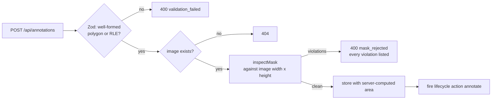
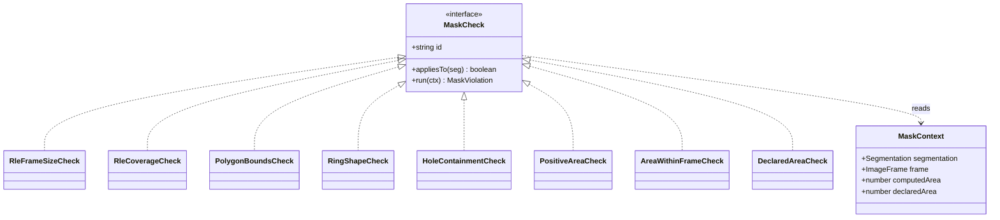
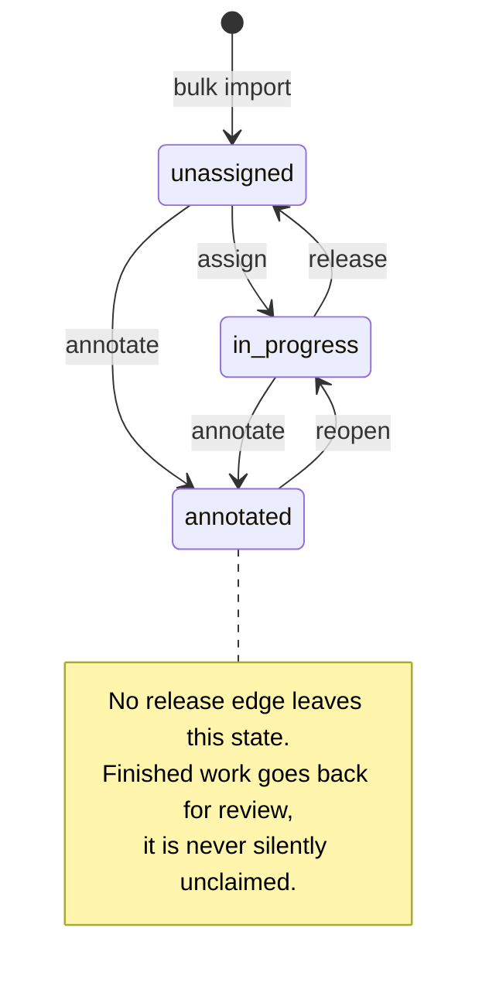

# Perle AI Segmentation API

An annotation tool draws masks on images. This service is what those masks are stored in, and
its job is mostly to say no.

A polygon whose vertices sit outside the frame, a run-length mask whose runs do not add up to
the number of pixels in the image, a ring that is really a straight line, a hole drawn beside
the shape it is meant to cut, a client that computed a different area from the one the
geometry implies: all of these round-trip through a naive store and come back out as training
data that is quietly wrong. Here they come back as a 400 that names every rule they broke:

```bash
curl -X POST http://localhost:7331/api/annotations \
  -H "X-API-Key: $ANNOTATOR_KEY" -H 'Content-Type: application/json' \
  -d '{"image":"6aef785f448a629ffd9bd933","label":"stop-sign",
       "segmentation":{"type":"polygon","polygons":[{"rings":[
         [[1900,100],[1950,100],[1950,150],[1900,150]],
         [[400,0],[420,0],[420,20],[400,20]]]}]}}'
```

```json
{"error":{"code":"mask_rejected","message":"the mask is not valid for this image",
  "details":[
    {"check":"polygon-bounds","code":"polygon_out_of_bounds",
     "message":"vertex (1950, 100) falls outside the 1920x1080 image"},
    {"check":"hole-containment","code":"hole_outside_outline",
     "message":"hole 1 of polygon 1 has vertex (400, 0) outside its outline"}]}}
```

A mask that passes is stored with the area the server computed, never the one the client sent,
and with the project taken from the image rather than from the request body.

Stack: TypeScript on Node 22, Express 5, MongoDB through Mongoose 9, Zod 4 for request shapes,
Vitest against a real in-memory `mongod`.

## Running it

The one command path is Docker Compose, which starts MongoDB 7 and the API together. The API
waits on Mongo's healthcheck, because it connects before it listens.

```bash
cp .env.example .env     # set ADMIN_API_KEY to a long random string
docker compose up --build
curl http://localhost:7331/api/health
```

```json
{"status":"ok","uptimeSeconds":17,"db":{"state":"connected"}}
```

If Mongo is unreachable, health answers 503 with `"status":"degraded"`. Compose reads
`ADMIN_API_KEY` from `.env` and falls back to a development-only key when it is unset. Mongo is
published on `7332`, so a `mongosh` shell on the host reaches the same data.

To run it outside Docker, use Node 22 (`.nvmrc`), point `MONGODB_URI` in `.env` at a running
`mongod`, and start the watcher:

```bash
npm ci
npm run dev    # -> Segmentation API listening on http://localhost:7331
```

The process reads `.env` with Node's own `process.loadEnvFile`, so there is no dotenv
dependency. In a container the variables come from the environment instead.

## A first session

Everything under `/api` except `/api/health` needs an `X-API-Key` header. `ADMIN_API_KEY` is the
bootstrap identity: it is an environment variable rather than a row, so a fresh database can
issue its first real key. Admins create projects, import images and issue keys. Annotators post
masks and read.

```bash
curl -X POST http://localhost:7331/api/users \
  -H "X-API-Key: $ADMIN_API_KEY" -H 'Content-Type: application/json' \
  -d '{"name":"Demo Annotator","email":"annotator@example.com"}'
```

```json
{"id":"6aef785f448a629ffd9bd931","name":"Demo Annotator","email":"annotator@example.com",
 "role":"annotator","apiKey":"<shown-once-annotator-key>"}
```

That `apiKey` is readable exactly once. The row stores its SHA-256 digest. Authorship is read
from the key, so a body that tries to name a different author with `createdBy` is rejected
rather than ignored.

The admin then creates a project and imports frames into it. Images carry their dimensions,
because every mask check is relative to them:

```bash
curl -X POST http://localhost:7331/api/projects/6aef785f448a629ffd9bd932/images \
  -H "X-API-Key: $ADMIN_API_KEY" -H 'Content-Type: application/json' \
  -d '{"images":[{"uri":"s3://demo-frames/frame-0001.png","width":1920,"height":1080}]}'
```

The annotator posts a polygon with a hole. The `area` field is optional and is only compared,
never stored:

```bash
curl -X POST http://localhost:7331/api/annotations \
  -H "X-API-Key: $ANNOTATOR_KEY" -H 'Content-Type: application/json' \
  -d '{"image":"6aef785f448a629ffd9bd933","label":"stop-sign","area":37500,
       "segmentation":{"type":"polygon","polygons":[{"rings":[
         [[100,100],[300,100],[300,300],[100,300]],
         [[150,150],[200,150],[200,200],[150,200]]]}]}}'
```

```json
{"project":"6aef785f448a629ffd9bd932","image":"6aef785f448a629ffd9bd933","label":"stop-sign",
 "segmentation":{"type":"polygon","polygons":[{"rings":[...]}]},
 "area":37500,"createdBy":"6aef785f448a629ffd9bd931","_id":"6aef785f448a629ffd9bd935",
 "createdAt":"2026-11-07T19:13:35.241Z","updatedAt":"2026-11-07T19:13:35.241Z","__v":0}
```

`docs/native-api.json` has the full session these examples come from, captured from the Compose
stack: nineteen exchanges including an RLE mask, two pages of a listing, ranks, stats, the COCO
export and the rejected cases.

## Eight rules a mask has to pass



Each rule is an object implementing one interface, and `inspectMask` walks the ordered registry
in `src/domain/mask/checks.ts` and collects every violation rather than stopping at the first.
A client fixing a mask learns everything wrong with it in one round trip. Adding a rule means
adding an entry to the array. No route, schema or controller changes.



| Check | Rejects |
|---|---|
| `rle-frame-size` | an RLE `size` that is not the image's `[height, width]` |
| `rle-coverage` | runs that do not sum to exactly `height * width` |
| `polygon-bounds` | a vertex outside the image |
| `ring-shape` | a ring with fewer than three vertices, or zero area |
| `hole-containment` | a hole with a vertex outside its own outline |
| `positive-area` | a mask that encloses no pixels |
| `area-within-frame` | a mask larger than its image |
| `declared-area` | a client `area` that differs from the computed one |

The order is deliberate: structural problems are reported before derived ones, so a client that
sent a truncated run list is told that, not that its area looks wrong. `appliesTo` is what
keeps the polygon rules from having to be defensive about RLE payloads and the other way round.

`MaskContext` carries the image dimensions, which is why none of this lives in the Zod schema:
the schema can tell you a payload is a well-formed polygon, but only the image row can tell you
whether it is a legal polygon *for that image*.

Hole containment exists because area is computed as outline minus holes. That is only true when
each hole is inside its outline. Without the check, a hole drawn beside the shape subtracted
pixels the mask never covered, and the stored area was too small.

## Where an image is in its lifecycle

`status` on an image is not a free-text field a handler can set to whatever it likes. Callers
name an action, and `src/domain/imageLifecycle.ts` decides whether that action has an edge out
of the current status. Imports cannot set a status either: every imported frame starts
`unassigned`.



Accepting a mask fires `annotate`. `PATCH /api/images/:id/status` fires the rest, and an action
with no edge is a 409 that lists the ones that do have edges:

```json
{"error":{"code":"illegal_transition","message":"cannot release an image that is annotated",
  "details":{"from":"annotated","allowed":["reopen"]}}}
```

The database write is a compare-and-set against the status that was read, so two annotators
finishing the same image do not both get told they made the transition.

## The routes

| Method | Path | Who |
|---|---|---|
| `GET` | `/api/health` | anyone |
| `POST` | `/api/users` | admin |
| `POST` | `/api/projects` | admin |
| `GET` | `/api/projects/:id` | any key |
| `GET` | `/api/projects/:id/stats` | any key |
| `GET` | `/api/projects/:id/export` | any key |
| `POST` | `/api/projects/:projectId/images` | admin |
| `GET` | `/api/images/:id` | any key |
| `GET` | `/api/images/:id/masks` | any key |
| `PATCH` | `/api/images/:id/status` | any key |
| `POST` | `/api/annotations` | any key |
| `GET` | `/api/annotations` | any key |
| `GET` | `/api/annotations/:id` | any key |
| `GET` | `/api/annotations/:id/rank` | any key |

`postman/PerleAI.postman_collection.json` has a request for each route, a second body for the
RLE encoding, and six rejected cases: twenty-one requests. Set `adminKey` and run the folders in
order. The requests capture the annotator key and the ids as they go. `tests/api/postman.test.ts`
reads the Express router and fails if the collection and the router disagree, so the two cannot
drift. Against the Compose stack:

```bash
npx newman run postman/PerleAI.postman_collection.json --env-var adminKey="$ADMIN_API_KEY"
```

Two routes exist to save round trips. `GET /images/:id/masks` ranks every mask on an image in
one request, instead of one `/annotations/:id/rank` call per mask:

```json
{"imageId":"6aef785f448a629ffd9bd933","total":2,"masks":[
  {"id":"6aef785f448a629ffd9bd936","label":"road","area":1036800,"rank":1,"createdBy":"6aef785f448a629ffd9bd931"},
  {"id":"6aef785f448a629ffd9bd935","label":"stop-sign","area":37500,"rank":2,"createdBy":"6aef785f448a629ffd9bd931"}]}
```

`/projects/:id/stats` groups by label and by annotator inside MongoDB, so its cost is set by the
number of distinct labels and annotators, not by the number of masks:

```json
{"projectId":"6aef785f448a629ffd9bd932","images":2,"annotations":2,
 "perLabel":[{"label":"road","count":1},{"label":"stop-sign","count":1}],
 "perAnnotator":[{"annotator":"6aef785f448a629ffd9bd931","count":2,
   "user":{"name":"Demo Annotator","email":"annotator@example.com"}}]}
```

Every error has the same shape, `{"error":{"code","message","details?"}}`. That includes bodies
the JSON parser refuses: malformed JSON is a 400 `invalid_json`, and a body over the 10 MB cap
is a 413 `payload_too_large`.

## Paging without offsets

`GET /api/annotations` pages by keyset, not by `skip`. Annotations sort by `_id` descending,
which for ObjectIds is insertion order, so a page is `{_id: {$lt: <last id seen>}}`. That is an
index seek whose cost does not grow as you page deeper.

```
GET /api/annotations?limit=1&imageId=6aef785f448a629ffd9bd933
-> {"limit":1,"items":[{"_id":"6aef785f448a629ffd9bd936",...}],"nextCursor":"NmFlZjc4NWY0NDhhNjI5ZmZkOWJkOTM2"}

GET /api/annotations?limit=1&imageId=6aef785f448a629ffd9bd933&cursor=NmFlZjc4NWY0NDhhNjI5ZmZkOWJkOTM2
-> {"limit":1,"items":[{"_id":"6aef785f448a629ffd9bd935",...}],"nextCursor":null}
```

There is no `total`: producing one costs a full index scan per page, and the query already knows
whether more exists because it asks for `limit + 1` rows and returns `limit`. Filters are
`label`, `annotator`, `imageId` and `projectId`, and `limit` is capped at 100.

## Getting the data out

`GET /api/projects/:id/export` returns the project as a COCO instance-segmentation document,
which is what a training pipeline expects to be handed. Categories are the labels actually
present, sorted and numbered from 1. `area` and `bbox` are recomputed from the geometry during
the export, so the file cannot disagree with the masks it describes. Polygons export with
`iscrowd: 0` and RLE masks with `iscrowd: 1`.

```json
{"info":{"description":"Road signs","project":"6aef785f448a629ffd9bd932","exported_count":2},
 "images":[{"id":"6aef785f448a629ffd9bd933","file_name":"s3://demo-frames/frame-0001.png","width":1920,"height":1080}, ...],
 "categories":[{"id":1,"name":"road","supercategory":"object"},{"id":2,"name":"stop-sign","supercategory":"object"}],
 "annotations":[{"id":"6aef785f448a629ffd9bd935","image_id":"6aef785f448a629ffd9bd933","category_id":2,
   "segmentation":{...},"area":37500,"bbox":[100,100,200,200],"iscrowd":0}, ...]}
```

This is the one deliberately unbounded read in the service: an export is a whole-project
operation by definition, and a paginated COCO file is not a COCO file.

## Settings

Every variable is declared in `src/config/env.ts` and parsed at startup, so a missing or
malformed one fails immediately with a message naming the field.

| Variable | Default | Meaning |
|---|---|---|
| `PORT` | `7331` | |
| `MONGODB_URI` | none | required |
| `ADMIN_API_KEY` | none | required, at least 16 characters |
| `REQUEST_LOG` | `dev` | Morgan format: `dev`, `combined` or `off` |

Page sizes, the float epsilon for area comparison and the 10 MB body cap an RLE run list needs
are named in `src/config/constants.ts` rather than inlined. The collections, fields and indexes
are described in [MODEL.md](MODEL.md).

## Tests

```bash
npm test           # vitest: 134 tests across 13 files
npm run lint       # eslint, flat config
npm run typecheck  # tsc --noEmit
npm run format:check
```

The API tests run against a real `mongod` that `mongodb-memory-server` downloads and starts in
memory, so the compound indexes, the aggregation pipelines and the compare-and-set status update
are exercised for real rather than against a stub that would agree with whatever the code
happens to do. MongoDB publishes no 7.0 build for arm64 Debian, so inside an arm64
`node:22-bookworm` container set `MONGOMS_DISTRO=ubuntu-22.04` before installing and testing.

## Things it does not do

- **No label suggestion, and no model in the loop.** The quality problem this service actually
  has is geometric, and geometry is deterministic. A suggester would be a second system to
  keep honest for no gain to the data.
- **No mask editing.** `POST /api/annotations` creates. There is no update or delete, so a
  correction is a new annotation.
- **No per-project membership.** A valid key can read any project. Roles separate who may
  write from who may read, not who may see what.
- **No claim ownership.** `assign` moves an image to `in_progress` but does not record who
  claimed it, so any key can `release` it again.
- **No rate limiting.** Writes need a key and a bulk import caps out at 1000 images, but
  nothing throttles a key that misbehaves.
- **No RLE decoding.** Run lists are validated for coverage and summed for area, never
  expanded into a bitmap, so the bounding box of an RLE mask is reported as the whole frame.
- **No self-intersection test.** Hole containment checks vertices against the outline; a
  bow-tie outline, or a hole whose edges cross a concave outline between two inside vertices,
  is not detected.

## License

MIT, see [LICENSE](LICENSE).
