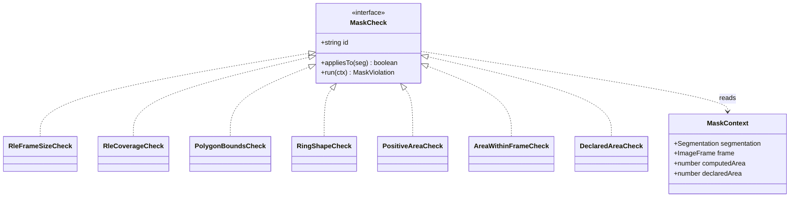
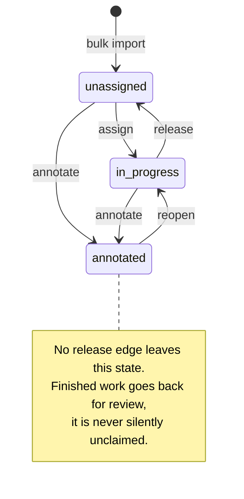
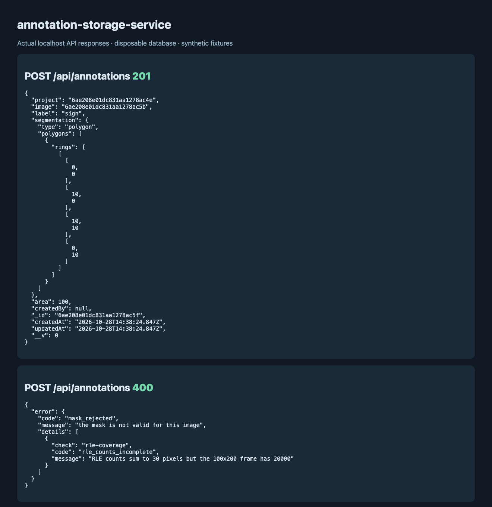

# Perle AI Segmentation API

An annotation tool draws masks on images. This service is what those masks are stored in, and
its job is mostly to say no.

A polygon whose vertices sit outside the frame, a run-length mask whose runs do not add up to
the number of pixels in the image, a ring that is really a straight line, a client that
computed a different area from the one the geometry implies — all of these round-trip through
a naive store and come back out as training data that is quietly wrong. Here they come back
as a 400 that names the rule:

```bash
curl -X POST http://localhost:7331/api/annotations \
  -H "X-API-Key: $ADMIN_API_KEY" -H 'Content-Type: application/json' \
  -d '{"image":"6aba5879eeabc09de713e316","label":"road",
       "segmentation":{"type":"rle","size":[1080,1920],"counts":[10,20]}}'
```

```json
{"error":{"code":"mask_rejected","message":"the mask is not valid for this image",
  "details":[{"check":"rle-coverage","code":"rle_counts_incomplete",
  "message":"RLE counts sum to 30 pixels but the 1080x1920 frame has 2073600"}]}}
```

A mask that passes is stored with the area the server computed, never the one the client sent,
and with the project taken from the image rather than from the request body.

## Seven rules a mask has to pass

Each rule is an object implementing one interface, and `inspectMask` walks the ordered
registry in `src/domain/mask/checks.ts` and collects every violation rather than stopping at
the first — a client fixing a mask learns everything wrong with it in one round trip. Adding
a rule means adding an entry to the array. No route, schema or controller changes.



`appliesTo` is what keeps the polygon rules from having to be defensive about RLE payloads and
the other way round. `MaskContext` carries the image dimensions, which is the reason none of
this lives in the Zod schema: the schema can tell you a payload is a well-formed polygon, but
only the image row can tell you whether it is a legal polygon *for that image*.

## Where an image is in its lifecycle

`status` on an image is not a free-text field a handler can set to whatever it likes. Callers
name an action, and `src/domain/imageLifecycle.ts` decides whether that action has an edge out
of the current status.



Accepting a mask fires `annotate`. `PATCH /api/images/:id/status` fires the rest, and an
action with no edge is a 409 that lists the ones that do have edges:

```json
{"error":{"code":"illegal_transition","message":"cannot release an image that is annotated",
  "details":{"from":"annotated","allowed":["reopen"]}}}
```

The database write is a compare-and-set against the status that was read, so two annotators
finishing the same image do not both get told they made the transition.

## Keys, roles, and who gets to say they drew something

Everything under `/api` except `/api/health` needs an `X-API-Key` header. A probe has no
identity, so health answers without one.

`ADMIN_API_KEY` is the bootstrap identity: it is an environment variable rather than a row, so
a fresh database can issue its first real key. Admins create projects, import images and issue
keys. Annotators post masks and read.

```bash
curl -X POST http://localhost:7331/api/users \
  -H "X-API-Key: $ADMIN_API_KEY" -H 'Content-Type: application/json' \
  -d '{"name":"Ada Lovelace","email":"ada@example.com"}'
```

```json
{"id":"6aba5879eeabc09de713e310","name":"Ada Lovelace","email":"ada@example.com",
 "role":"annotator","apiKey":"CPh26RGReM0vVEEcMjs6MUIhJ4OEP9Et"}
```

That `apiKey` is the only time the key is readable — the row stores its SHA-256 digest. The
point of all this is `createdBy`: authorship is read from the key, and a body that tries to
name a different author is rejected rather than ignored.

## Running it

```bash
npm install
cp .env.example .env          # set MONGODB_URI and a long ADMIN_API_KEY
npm run dev                   # -> Segmentation API listening on http://localhost:7331
curl http://localhost:7331/api/health
```

`{"status":"ok","uptimeSeconds":25,"db":{"state":"connected"}}` means Mongo answered. If it
did not, health returns 503 with `"status":"degraded"` — the process connects before it
listens, so it never accepts traffic it cannot serve.

With Docker, `docker compose up --build` starts Mongo and the API together and the API waits
on Mongo's healthcheck. Mongo is published on `7332`, so a `mongosh` shell on the host reaches
the same data. The test suite does not use it — it starts its own `mongod`.

## The routes

`.postman/PerleAI.postman_collection.json` has a request for each of these, a second body for
the RLE encoding, and six negative cases — twenty-one requests. `tests/api/postman.test.ts`
reads the Express router and fails if the collection and the router disagree, so it cannot
drift.

| Method | Path | Who |
|---|---|---|
| `GET` | `/api/health` | anyone |
| `POST` | `/api/users` | admin |
| `POST` | `/api/projects` | admin |
| `GET` | `/api/projects/:id` | any key |
| `GET` | `/api/projects/:id/stats` | any key |
| `GET` | `/api/projects/:id/export` | any key |
| `POST` | `/api/projects/:projectId/images` | admin |
| `GET` | `/api/images/:id` | any key |
| `GET` | `/api/images/:id/masks` | any key |
| `PATCH` | `/api/images/:id/status` | any key |
| `POST` | `/api/annotations` | any key |
| `GET` | `/api/annotations` | any key |
| `GET` | `/api/annotations/:id` | any key |
| `GET` | `/api/annotations/:id/rank` | any key |

Two of those exist to kill round trips. `GET /images/:id/masks` ranks every mask on an image
in one request — the alternative is one `/annotations/:id/rank` call per mask. And
`/projects/:id/stats` groups by label and by annotator inside MongoDB, so its cost is set by
the number of distinct labels and annotators, not by the number of masks.

## Paging without offsets

`GET /api/annotations` pages by keyset, not by `skip`. Annotations sort by `_id` descending,
which for ObjectIds is insertion order, so a page is `{_id: {$lt: <last id seen>}}` — an index
seek whose cost does not grow as you page deeper.

```
GET /api/annotations?limit=20&label=stop-sign
-> { "limit": 20, "items": [...], "nextCursor": "NmFiYTU4..." }

GET /api/annotations?limit=20&label=stop-sign&cursor=NmFiYTU4...
```

`nextCursor` is null on the last page. There is no `total`: producing one costs a full index
scan per page, and the query already knows whether more exists because it asks for `limit + 1`
rows and returns `limit`. Filters are `label`, `annotator`, `imageId` and `projectId`, and
`limit` is capped at 100.

## Getting the data out

`GET /api/projects/:id/export` returns the project as a COCO instance-segmentation document —
`images`, `categories`, `annotations` with `bbox` and `iscrowd` — which is what a training
pipeline expects to be handed. Categories are the labels actually present, sorted and numbered
from 1. `area` and `bbox` are recomputed from the geometry during the export, so the file
cannot disagree with the masks it describes.

This is the one deliberately unbounded read in the service: an export is a whole-project
operation by definition, and a paginated COCO file is not a COCO file.

## Settings

Every variable is declared in `src/config/env.ts` and parsed at startup, so a missing or
malformed one fails immediately with a message naming the field.

| Variable | Default | Meaning |
|---|---|---|
| `PORT` | `7331` | |
| `MONGODB_URI` | — | required |
| `ADMIN_API_KEY` | — | required, at least 16 characters |
| `REQUEST_LOG` | `dev` | Morgan format, or `off` |

Page sizes, the float epsilon for area comparison and the 10 MB body cap an RLE run list
needs are named in `src/config/constants.ts` rather than inlined.

## Tests

```bash
npm test          # vitest
npm run lint      # eslint, flat config
npm run typecheck # tsc --noEmit
```

123 tests pass across 13 files. The API tests run against a real `mongod` started in memory by
`mongodb-memory-server`, so the compound indexes, the aggregation pipelines and the
compare-and-set status update are exercised for real rather than against a stub that would
agree with whatever the code happens to do.

## Things it does not do

- **No label suggestion, and no model in the loop.** The quality problem this service actually
  has is geometric, and geometry is deterministic. A suggester would be a second system to
  keep honest for no gain to the data.
- **No mask editing.** `POST /api/annotations` creates. There is no update or delete, so a
  correction is a new annotation.
- **No per-project membership.** A valid key can read any project. Roles separate who may
  write from who may read, not who may see what.
- **No rate limiting.** Writes need a key and a bulk import caps out at 1000 images, but
  nothing throttles a key that misbehaves.
- **No RLE decoding.** Run lists are validated for coverage and summed for area, never
  expanded into a bitmap, so the bounding box of an RLE mask is reported as the whole frame.

## A running API exchange



This capture displays responses from a native server backed by a disposable
MongoDB: a polygon was saved with server-computed area 100, and an incomplete
RLE mask was rejected with HTTP 400. The complete requests and responses are in
[the exchange record](docs/native-api.json). The image URI is a synthetic fixture.
